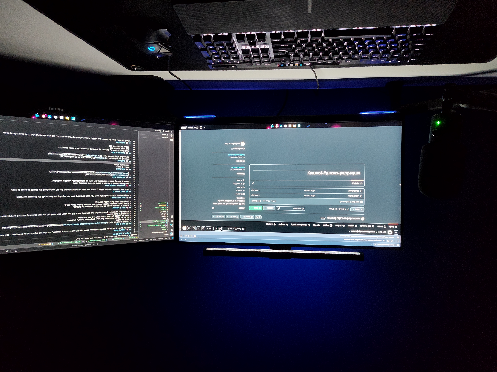
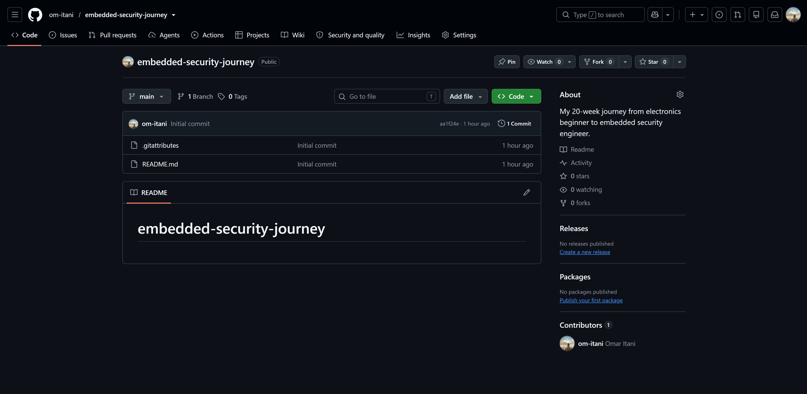

# Day 0 — 2026-10-16

## 🎯 Today's Focus
Today is Day 0. I set up my GitHub README.md, added the MIT and CC-BY-4.0 licenses, and started organising my workspace — the foundation for the next 20 weeks.

## ✅ What I Did
- Created my GitHub repo: [github.com/om-itani/embedded-security-journey](https://github.com/om-itani/embedded-security-journey)
- Wrote my README
- Set up my folder structure: journal/, projects/, notes/, writeups/
- Added my LICENSE (MIT for code, CC-BY-4.0 for writeups)
- Installed VS Code and Git

## 🧠 What I Learned
- Without a license, a repo is All Rights Reserved by default.
- GitHub commit messages follow conventions (docs:, feat:, fix:, etc.).
- The hardest step is actually starting.

## 🔧 What Went Wrong
- Everything was pretty straightforward. The most confusing part was figuring out how to add the licenses correctly.

## 🩹 How I Fixed It
- Split the licenses into two files (LICENSE for MIT, LICENSE-CC-BY-4.0 for CC) and updated the README to point to both.

## ❓ Questions I Still Have
- What other devices I own can I learn embedded security with?
- How do I turn my domain (omaritani.dev) into an automatically updating portfolio?

## 🔗 Resources Used
- [choosealicense.com](https://choosealicense.com)
- [creativecommons.org/licenses/by/4.0](https://creativecommons.org/licenses/by/4.0/)

## ⏱️ Time Spent
- Total: 2 hours
- Deep work: 1 hour

## 📸 Evidence
- Photo of my workspace: 
- Screenshot of my GitHub repo: 

## 🗓️ Tomorrow's Plan
- Read Phase 1, Week 1, Day 1 of my learning system (Blink & Basic Circuits)
- Set up my Arduino IDE
- Blink the built-in LED

## 💭 Reflection
I feel excited. Ready to learn a new skill, finally unleash my full potential, and show the world what I've been holding back.
